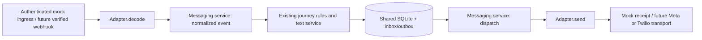

# Mock WhatsApp integration

The mock channel runs the active Store IQ journey without a phone number, Meta,
Twilio, or any messaging network calls. It shares customers and history with the
website. It is a developer API simulator, not a WhatsApp-looking browser UI.
Only synthetic data should be used.

## Adapter boundary



`app/messaging/contracts.py` defines `MessagingAdapter`, `IncomingMessage`,
`OutgoingMessage`, `SendReceipt` and `DeliveryUpdate`. The stable business calls are:

```python
await service.receive(event, authenticated_associate, adapter)
await service.dispatch(outbox_id, authenticated_associate, adapter)
service.delivery(outbox_id, update, authenticated_associate, adapter.name)
```

The adapter decodes provider wire formats and performs outbound transport. The
service owns customer authorization, optimistic versions, durable event identity,
journey execution and delivery state. The mock recipient is a logical associate
ID, not a telephone number. A live adapter must resolve that ID through an approved
test-recipient binding. No caller-supplied phone grants access to a customer.

To add a provider, implement the protocol and add its configuration/factory branch
in `adapters.py`. Add a provider-authenticated ingress that resolves the associate,
active customer and action version from trusted bindings, then calls these same
service functions. Normalize signed delivery callbacks to `DeliveryUpdate` too.
Meta challenge/signature handling and Twilio signature handling belong at that
provider boundary. They must not reuse the mock session-authenticated ingress as
an unauthenticated public webhook. Existing business call sites do not change.

Only `mock` is implemented. `WHATSAPP_PROVIDER=meta`, `twilio`, `disabled`, or any
unknown value fails closed; changing configuration alone does not implement a live
provider. Legacy `META_MODE` and `app/meta` remain separate and unserved.

## Try it

Use the usual Python environment and run the API:

```powershell
.venv/Scripts/python.exe -m uvicorn app.main:app --host 127.0.0.1 --port 8000
```

The mock requires `WHATSAPP_PROVIDER=mock`, `ENABLE_DEV_ROUTES=true`, and
`DEMO_MODE=true`. These are the development defaults; restart after configuration
changes. Production demo restrictions still apply. No real provider key is needed.

In another terminal:

```powershell
.venv/Scripts/python.exe -m scripts.try_mock_whatsapp
```

Enter the associate password when prompted (`Associate@123` for the seeded demo
associate). The script creates a synthetic visit and sends deterministic home
answers through the mock channel, printing replies/buttons. It does not invoke AI.
The saved customer can be resumed in the website. Free-form AI questions still use
the configured real AI provider: mocking transport does not mock intelligence.

## HTTP contract

All endpoints require the website's session cookie and its existing same-origin
write checks. Sign in through `POST /api/auth/login`; create/select a customer using
the existing customer API. Use the customer's latest version for every new event.

| Method and route | Behavior |
| --- | --- |
| `POST /api/messaging/mock/events` | Decode and apply a text/action event; return inbox status and saved outbound messages |
| `GET /api/messaging/mock/outbox?customer_id=...` | Inspect the current associate's saved messages; customer filter is optional |
| `POST /api/messaging/mock/outbox/{id}/retry` | Retry delivery only, with the original idempotency key |
| `POST /api/messaging/mock/outbox/{id}/delivery` | Simulate delivered/read/failed for the matching provider receipt |

Text example:

```json
{
  "event_id": "unique-client-event-1",
  "customer_id": "saved-customer-id",
  "version": 2,
  "kind": "text",
  "text": "8 feet"
}
```

Action example (the same validated action/data as the website):

```json
{
  "event_id": "unique-client-event-2",
  "customer_id": "saved-customer-id",
  "version": 3,
  "kind": "action",
  "action": "home_answer",
  "data": {"field": "light", "value": "Bright daylight"}
}
```

Reply buttons retain `action`, `input` and `navigate` semantics. An `input` button
requires collecting the corresponding form fields; a `navigate` button must open
the website, not execute a business action. Future live channel rendering must
implement those interactions. Every outbound envelope has at most three logical
lines and three buttons; physical text wrapping depends on the client screen.

## Reliability and limits

- Inbox keys include provider, authenticated associate and event ID. Identical
  replays return saved results; reusing an ID with different content returns 409.
- Deterministic actions/text, inbox completion and outbox creation commit in one
  SQLite transaction. A rollback cannot leave a sale without its queued reply.
- AI calls happen outside transactions. The existing text service deduplicates
  request IDs; retryable AI failures preserve one user message. Saved assistant
  responses allow recovery if processing ended before outbox creation.
- Stale new events return 409. Refresh the customer and submit a new event ID.
  Replaying an already completed event does not re-run the action even if the
  customer has since changed. A short processing lease rejects simultaneous work.
- Outbound attempts have a lease and 15-second timeout. Failure/uncertainty leaves
  a retryable outbox record. A mock acceptance receipt survives restarts and a
  timeout after acceptance; the same key does not create a second mock receipt.
  Multipart replies send in order. If one fails, later parts remain pending;
  retry the failed part first, then the remaining parts through the retry endpoint.
- Real providers must honor the idempotency key or reconcile ambiguous sends
  before retrying. This interface does not claim exactly-once external delivery.
- Acceptance is distinct from delivery. Mock receipts explicitly say
  `simulated=true`; delivered/read statuses are only simulations. Late callbacks
  cannot downgrade read to delivered/failed. A callback must match its saved receipt.
- Queues survive restarts; retries are explicit API operations in this version.
  There is no background delivery worker, public webhook, automatic delayed expert
  notification forwarding, provider-media download/OCR, or external summary
  delivery yet. The simulator selects an existing customer explicitly; a WhatsApp
  customer-selection lobby and real phone identity binding remain live-channel work.
- Audio-file transcription/translation now has a separate [reviewed voice pipeline](voice-input.md).
  Use it with the same saved customer while testing locally. The messaging event
  schema itself remains text/actions; live provider media intake is still pending.
- Requests are synchronous; this version makes no sub-five-second live-channel
  acknowledgement claim. A live ingress should acknowledge quickly and queue work.

Run `python -m unittest tests.test_messaging -v` for isolated HTTP/SQLite coverage.
